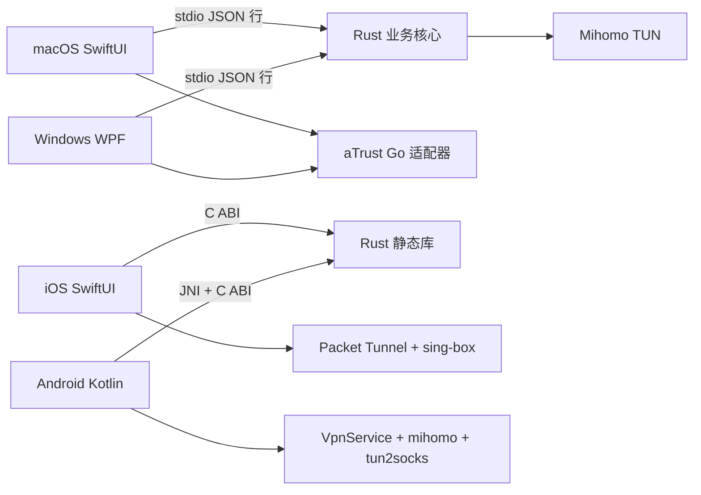

# 轻舟（split-vpn）

跨平台网络分流与连接管理工具。共享 Rust 核心负责订阅、节点与规则，macOS / Windows / iOS / Android 使用各自的原生界面和系统 VPN 接入。

当前源码版本为 **0.6.5**。桌面端提供 aTrust 私有网络接入；地址和账号由用户配置，EasyConnect 尚未接入。各端安装包和真实联网按平台分别验收。

macOS / Windows 已接入网络切换、断网恢复和睡眠唤醒的自动处理，并根据窗口可见性与系统省电状态减少后台工作，详见 [macOS](apps/macos-native/README.md#网络切换与后台省电) / [Windows](apps/windows/README.md#网络切换与后台省电)。Windows 原生通知与实际耗电量仍待实机测试。

## 能做什么

- 导入 Clash / Mihomo / URI 订阅，管理节点、收藏、分组和测速。
- 按域名与网络规则分流，保留局域网、Tailscale、NAS 和路由器的直连访问。
- 查看连通性、流量、风险与脱敏日志。
- 在 macOS / Windows 登录私有网络，获取授权资源，通过 TCP 隧道接入。

需要 Shadowrocket 格式的订阅，可在服务商提供的网址中显式设置 `list=shadowrocket`；源码不根据服务商域名自动选择格式。

订阅默认每天自动更新，也可设为 5～10080 分钟或仅手动更新。下载失败保留上次可用节点；内容不变时保留连接，当前节点失效时安全断开并提示重新选择。

桌面端可选择默认直连或默认 VPN。Geo 数据缺失时，可使用内置国内域名名单、跟随默认策略，或拒绝启动；数据完整时使用完整分流规则。

## 如何填写分流规则

在桌面端打开“分流规则”→“添加规则”，先选择 **走 VPN** 或 **直连**，再填一个地址。“走 VPN”使用当前选中的节点或节点组；“直连”使用本机网络。默认的“自动识别”即可处理常见地址：

| 想匹配的地址 | 填写示例 | 匹配范围 |
|---|---|---|
| 域名及其子域名 | `example.test` | 包含 `example.test`、`api.example.test` 等 |
| 仅一个域名 | 选择“仅此域名”，填 `api.example.test` | 不包含该域名的子域名 |
| 单个 IP | `192.0.2.8` | 只匹配这个 IP |
| IP 网段 | `192.0.2.0/24` 或 `2001:db8::/32` | 匹配该网段内的 IP |
| 粘贴网址 | `https://example.test/path` | 自动取地址；路径和端口不参与分流 |

每条规则只填一个地址。填写后会显示匹配范围和出口，格式错误时保留输入并提示修正。编辑已有规则可以直接换出口，相同匹配条件不会同时保留两个出口；不同范围重叠时，直连规则优先。

自定义地址规则优先于国内外自动分流；二者都没有匹配时才使用“未命中策略”。局域网、Tailscale 与私有网络接入仍遵循各自设置。“检查匹配”只查看自定义规则，不测试真实联网，也不查询域名对应的 IP。移动端沿用现有规则界面，共享核心能够保留并生成直连规则。

macOS / Windows 开启局域网直连时，内网 IP 请求保留原始目标，跳过可能改写目标的 HTTP 域名识别，避免漏过局域网规则后被送入 VPN。远程授权资源仍优先走私有网络接入出口。

macOS 接入私有网络时保留正在使用的本地物理网段，普通应用访问这些本地地址仍沿用系统直连路由，避免公司授权范围覆盖办公网段时重复创建 TUN 路由。接管后检查内核实际网卡与 TUN 状态；未确认成功就恢复原配置，不报告接管成功。

## 架构与目录

| 目录 | 内容与说明 |
|---|---|
| [packages/vpn-core](packages/vpn-core/README.md) | Rust 核心、桌面 RPC、移动端 C ABI |
| [packages/company-vpn](packages/company-vpn/README.md) | 固定上游版本、aTrust 补丁与 Go 接入适配器 |
| [apps/macos-native](apps/macos-native/README.md) | SwiftUI / AppKit 客户端、菜单栏与系统接入 |
| [apps/windows](apps/windows/README.md) | WPF 客户端、自包含 Windows x64 包 |
| [apps/iphone](apps/iphone/README.md) | SwiftUI、App Group 与 Packet Tunnel |
| [apps/android](apps/android/README.md) | Kotlin、JNI 与前台 VpnService |
| `resources/mihomo/` | 第三方桌面内核与 Geo 数据的本地放置位置，准备方法见下文 |
| `design/app-icon-qingzhou-ink/` | 图标源图、iconset 与生成说明 |
| [docs](docs/README.md) | 开发指南、源码快照说明及第三方依赖说明 |
| `release/` | 本机安装包、回退版本与整理记录，Git 忽略 |

这是独立源码快照，不含预编译内核、Geo 数据、签名文件、安装包或历史文档。Rust 核心和 macOS SwiftPM 可分别构建与测试；生成完整安装包前，先按 [第三方依赖说明](docs/THIRD_PARTY.md) 准备所需资源。构建、测试和打包命令见 [开发指南](docs/DEVELOPMENT.md)。

## 用户数据与安全

| 平台 | 数据位置 |
|---|---|
| macOS | `~/Library/Application Support/@split-vpn/desktop` |
| Windows | `%APPDATA%\@split-vpn\desktop`；界面偏好在 `%LOCALAPPDATA%\Qingzhou` |
| iOS | App Group 下的 `core/` 和 `generated/` |
| Android | `filesDir/split-vpn/` |

桌面沿用旧版的数据格式和目录，保留未知设置字段，升级无需导出导入。日志中的订阅 URL、密钥和接入凭据脱敏；macOS 密码保存在钥匙串，Windows 凭据使用 DPAPI。控制器只监听本机回环地址并使用随机密钥，验证码与认证会话不持久化。

## 许可证与公开发布

原创代码保留根目录 [Apache-2.0](LICENSE)；接入适配代码沿用其目录内的 [AGPL-3.0](packages/company-vpn/LICENSE)。第三方组件的源码、许可证及安装包声明分别整理，见 [第三方依赖说明](docs/THIRD_PARTY.md)。源码快照范围与隐私检查见 [源码说明](docs/SOURCE_SNAPSHOT.md)。
